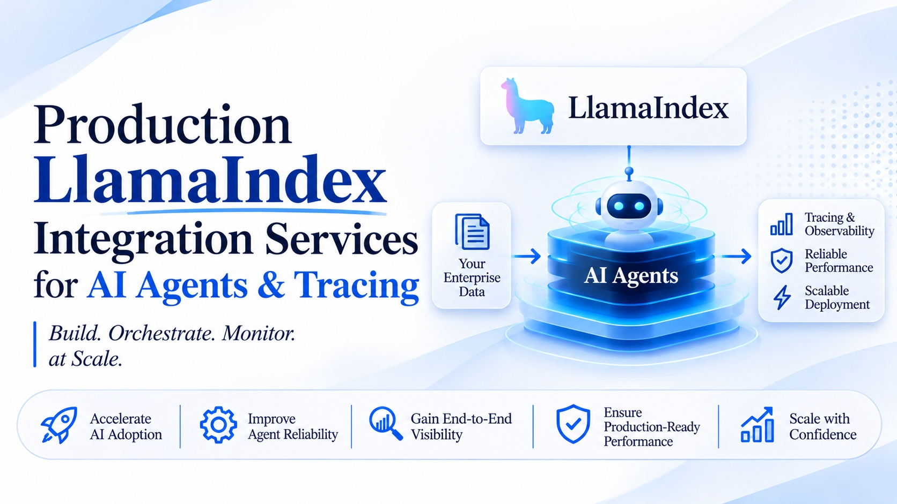

# Production LlamaIndex Integration Services for AI Agents & Tracing



Building a LlamaIndex agent that answers well in a notebook takes an afternoon. Keeping it correct, fast, affordable, and explainable for thousands of users takes engineering. The gap between the two is mostly about visibility: when an agent picks a tool, retrieves a passage, and writes an answer, can you see exactly why?

That is why teams look for [production LlamaIndex integration services](https://zignuts.com/ai-services/ai-integration/llamaindex-integration-services?utm_source=seo_web2.0&utm_medium=backlink&utm_campaign=seo_referral&utm_id=11) that treat ingestion, retrieval, agent logic, and tracing as one engineered system rather than a collection of scripts.

## What a Production Stack Covers

| Layer | Its job | Production concern |
|---|---|---|
| **Ingestion** | Load, parse, chunk, and embed documents | Repeatable runs, updates, deletes, parsing quality |
| **Indexing** | Store vectors and metadata for search | Tenant isolation, filters, re-embedding plans |
| **Retrieval** | Find the right passages | Recall, reranking, permission-aware filters |
| **Query engines** | Combine retrieval with a model to answer | Citations, thresholds, safe refusals |
| **Agents and tools** | Plan steps and call tools | Scope, step limits, approvals, timeouts |
| **Tracing** | Record every step of every run | Cost, latency, privacy, debugging speed |

## Minimal Example

```python
from llama_index.core import SimpleDirectoryReader, VectorStoreIndex

docs  = SimpleDirectoryReader("policies/").load_data()
index = VectorStoreIndex.from_documents(docs)

query_engine = index.as_query_engine(similarity_top_k=5)
answer = query_engine.query("What is the contractor retention period?")

# In production: attach tracing, filters, and citation checks here.
```

LlamaIndex APIs evolve quickly. Check the current LlamaIndex documentation before you build.

## Anatomy of a Trace

A trace shows one request as a tree of steps. This sketch is illustrative.

```
agent.run
├── retrieve
├── rerank
├── llm.plan
├── tool.lookup_account
└── llm.answer
```

Each step records its time, inputs, and outputs, so a slow or wrong answer can be traced to a specific step.

## Designing Agents Safely

- [ ] Each agent has a narrow job and a small tool set
- [ ] Tools have precise names, inputs, and limits
- [ ] Steps and time are capped to prevent loops
- [ ] Reads are separated from writes, and writes need approval
- [ ] Tools run with the requesting user's permissions
- [ ] Tool errors, empty retrievals, and timeouts have fallbacks

## What to Capture in Traces

| Capture | Why |
|---|---|
| Step names, order, and timing | Finds the slowest step and loops |
| Retrieved document ids and scores | Explains why an answer used a source |
| Prompts and model versions | Lets you reproduce and compare behavior |
| Tool calls, inputs, and outputs | Shows what actions the agent took |
| Token counts and cost | Connects behavior to spend |
| User tier, tenant, and feature tags | Lets you slice problems by segment |

Traces can contain sensitive data. Redact fields before export, restrict access, and set a retention period.

## Evaluate and Monitor

1. **Build a golden dataset** from real questions with expected sources or answers.
2. **Score retrieval and answers separately.**
3. **Gate releases** on quality, latency, and cost against a baseline.
4. **Sample live traffic** and review the worst traces.
5. **Feed failures back** into the dataset.

## Get Started

Ready to run LlamaIndex agents you can explain? Visit [zignuts.com](https://zignuts.com/) to speak with the team.

## Publish with GitHub Pages

1. Add `llamaindex-agentic-production.jpg` to the repository root.
2. Go to **Settings > Pages**, choose the `main` branch and the `/ (root)` folder, then save.
3. The site will be available at `https://harshp-zigs.github.io/llamaindex-enterprise-rag-pipeline/`.

## Topics

`llamaindex` `ai-agents` `llm-tracing` `observability` `rag-pipeline` `agent-workflows` `production-ai`
